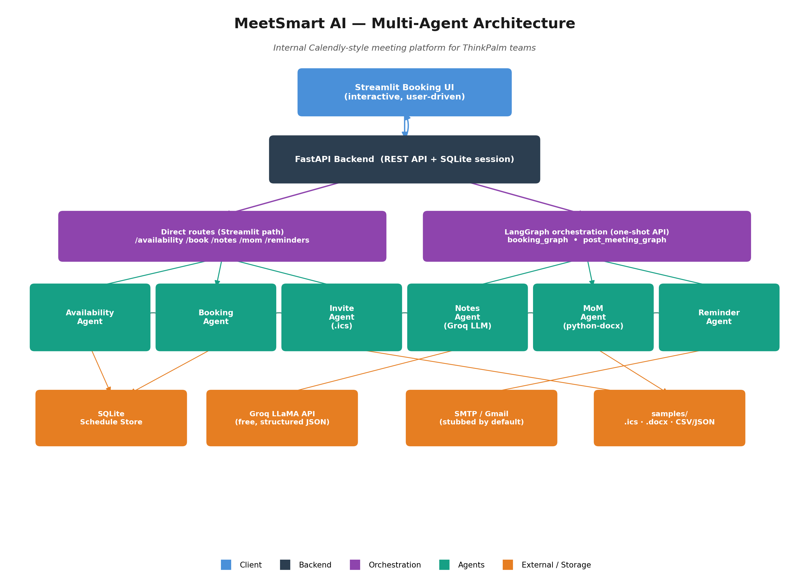

# MeetSmart AI — Internal Calendly-Style Meeting Platform

Full-stack agentic meeting-booking platform for internal teams, from slot discovery to post-meeting delivery, built entirely with free tools.



## Architecture (multi-agent)

1. **Availability Agent** — reads/writes SQLite schedule store, surfaces open slots
2. **Booking Agent** — checks all participants' availability, picks optimal slot, confirms booking
3. **Invite Agent** — generates `.ics` invite, sends via SMTP (stubbed for now — see `EMAIL_ENABLED`)
4. **Notes Agent** — ingests transcript/notes text, produces structured notes + action items
5. **MoM Agent** — drafts a formal Minutes of Meeting Word doc, saves it, emails it (stubbed for now)
6. **Reminder Agent** — pre-meeting reminders + post-meeting follow-ups (stubbed for now)

Agents are orchestrated with **LangGraph**.

## Stack

- Backend: FastAPI + SQLite
- Frontend: Streamlit (booking UI)
- LLM: Groq (free LLaMA API) — same as the mini project
- Docs: python-docx, icalendar
- Email: smtplib (stub mode by default)

## Project layout

```
meetsmart-ai/
├── backend/
│   └── app/
│       ├── main.py            # FastAPI app, routes
│       ├── models.py          # SQLAlchemy models
│       ├── database.py        # SQLite engine/session
│       ├── schemas.py         # Pydantic schemas
│       ├── graph.py           # LangGraph orchestration
│       ├── agents/
│       │   ├── availability_agent.py
│       │   ├── booking_agent.py
│       │   ├── invite_agent.py
│       │   ├── notes_agent.py
│       │   ├── mom_agent.py
│       │   └── reminder_agent.py
│       └── db/
│           └── seed.py        # sample employees + schedules
├── frontend/
│   └── app.py                 # Streamlit booking UI
├── samples/                   # sample .ics / MoM outputs land here
├── docs/                      # architecture diagram goes here
├── requirements.txt
├── .env.example
└── README.md
```

## Setup

```bash
cd backend
python -m venv venv
venv\Scripts\activate        # Windows
pip install -r ../requirements.txt

copy ..\.env.example .env    # then fill in GROQ_API_KEY (free — console.groq.com)
python -m app.db.seed        # seed sample employees + schedules
uvicorn app.main:app --reload --port 8000
```

In a second terminal:

```bash
cd frontend
streamlit run app.py
```

## Email / SMTP

Email sending is **stubbed by default** (`EMAIL_ENABLED=false` in `.env`).
Stubbed sends are logged to console and saved under `samples/` instead of
actually emailed. Flip `EMAIL_ENABLED=true` and fill in `SMTP_*` vars once a
Gmail app password is ready — no code changes needed.

## API reference

| Method | Route | Purpose |
|---|---|---|
| GET | `/health` | Health check |
| GET | `/employees` | List seeded employees |
| POST | `/availability` | Find common free slots for given participants/date |
| POST | `/book` | Book a specific slot (Booking Agent + auto-generates invite) |
| POST | `/notes` | Structure raw meeting notes into summary + action items (Notes Agent) |
| POST | `/mom/{meeting_id}` | Generate + save the Minutes of Meeting Word doc (MoM Agent) |
| POST | `/reminders/pre-meeting/{meeting_id}` | Send pre-meeting reminders to all participants |
| POST | `/reminders/follow-up/{meeting_id}` | Send follow-ups for pending action items |
| POST | `/orchestrate/book` | **LangGraph**: Availability → Booking → Invite, one call |
| POST | `/orchestrate/post-meeting` | **LangGraph**: Notes → MoM → Reminders, one call |
| GET | `/export/action-items` | Action-item tracker export — JSON (default) or `?format=csv` |

Full interactive docs (Swagger UI) at `http://localhost:8000/docs` once the backend is running.

## Deliverables checklist

**Agents & orchestration**
- [x] Availability Agent
- [x] Booking Agent
- [x] Invite Agent
- [x] Notes Agent
- [x] MoM Agent
- [x] Reminder Agent
- [x] LangGraph orchestration (`backend/app/graph.py`, `/orchestrate/*` routes)

**Submission deliverables**
- [x] Working prototype (this repo)
- [x] README + multi-agent architecture (this file; diagram in `docs/`)
- [x] Booking UI (Streamlit) showing employee availability
- [x] Sample `.ics` invite — generated per booking, saved under `samples/`
- [x] Sample MoM Word doc — generated per meeting, saved under `samples/` (+ emailed, stubbed)
- [x] Action-item tracker output (CSV/JSON export)
- [ ] Architecture diagram (PNG)
- [ ] 15-min demo video
- [ ] GitHub repo published

## Notes on the "no paid APIs" requirement

The original spec listed "Claude API (programme key)" for the LLM step.
This build uses **Groq's free LLaMA API** instead (`llama-3.3-70b-versatile`)
for the Notes Agent, since no programme key was available — functionally
equivalent (fast, structured JSON output) and keeps the whole stack free,
consistent with every other tool choice in this project.

## Testing status

Every agent and both LangGraph graphs have been manually verified end-to-end:
availability lookup correctly skips busy slots, booking rejects double-bookings,
`.ics` invites open correctly, structured notes/action-items are accurate,
the generated MoM Word doc was rendered and visually checked, and both
reminder types (pre-meeting + follow-up) correctly target the right
recipients while skipping completed action items.

## LangGraph orchestration

Two compiled graphs live in `backend/app/graph.py`:

- **`booking_graph`** — Availability → Booking → Invite. Given participants
  and a date, auto-picks the first common free slot and books it end to end.
  Exposed at `POST /orchestrate/book`.
- **`post_meeting_graph`** — Notes → MoM → Reminders. Given a meeting ID and
  raw notes, structures them, drafts the MoM, and sends follow-ups for any
  pending action items. Exposed at `POST /orchestrate/post-meeting`.

The interactive Streamlit UI calls the individual agent routes directly
(so you can pick a specific slot and review notes before committing) —
these graphs are the autonomous, one-shot orchestration path, useful for
demoing the multi-agent pipeline or scripting it from the CLI:

```bash
curl -X POST http://localhost:8000/orchestrate/book \
  -H "Content-Type: application/json" \
  -d '{"title":"Sprint Review","organizer_email":"ismail@thinkpalm.com","participant_emails":["priya@thinkpalm.com"],"date":"2026-07-22"}'
```
